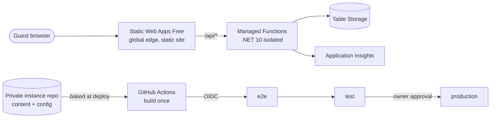

# WeddingPlanner

A mobile-first wedding invitation and RSVP site that runs on Azure for about €0 per month.

> **Status: under construction.** This README is a skeleton. Features are being built in small,
> reviewed steps; anything not on `main` yet is marked _planned_. Screenshots and the full guides
> follow once the site is live.

<!-- Hero screenshot (sample content, fictional couple Anna & Ben) is added with the README polish. -->

## What it is

A classy one-pager for a wedding: the couple, the schedule, locations and hotels, the wedding party,
FAQ and contacts, in German, English and Spanish, plus an RSVP form and a small admin area. One
codebase serves any number of deployments; each wedding's content lives in its own private repo.

Features (all _planned_):

- **One-pager with modular sections:** which sections appear, in which order and with which
  template is configured per deployment.
- **Three languages:** de, en, es, with a language switcher.
- **Open RSVP:** up to five companions, per-person dietary options and a note, a message to the
  couple; guests can revisit and edit their answer (cookie and personal edit link).
- **Admin area** (Microsoft sign-in, invited admins only): responses with totals, guest list with
  CSV import, fuzzy matching of responses to the guest list, CSV export, RSVP deadline settings.
- **Privacy by design:** no tracking, self-hosted fonts, the map loads only after a click.

## Architecture



Details: [docs/architecture.md](docs/architecture.md) and the decision records in
[docs/adr/](docs/adr/README.md).

## Tech stack

- **Web:** Vite, React, TypeScript; Biome for linting and formatting; Vitest and Testing Library.
- **API:** Azure Functions (.NET 10 isolated worker) as the managed API of Azure Static Web Apps;
  Azure Table Storage; xUnit.
- **Content:** Zod schemas with generated JSON Schemas; content and images baked into the static
  build.
- **Infrastructure:** Bicep, GitHub Actions with OIDC, three environments (e2e, test, production).
- **End-to-end:** Playwright across a phone, tablet and desktop device matrix, with screenshots.

## Repo map

| Path                | Contents                                                                                 |
| ------------------- | ---------------------------------------------------------------------------------------- |
| `apps/web/`         | public one-pager and admin entry (`@weddingplanner/web`)                                 |
| `apps/api/`         | .NET Functions API and its tests                                                         |
| `packages/`         | content schemas and bake (`@weddingplanner/content`), API contracts, .NET domain library |
| `tests/e2e/`        | Playwright device matrix, screenshots, read-only smoke tests                             |
| `samples/instance/` | the complete fictional sample deployment (Anna & Ben)                                    |
| `infra/`            | Bicep for bootstrap (owner-run) and app resources (CI-run)                               |
| `scripts/`          | owner-run scripts: bootstrap, GitHub setup, operations                                   |
| `docs/`             | architecture, conventions, ADRs, runbooks                                                |

Folders appear as the corresponding work lands.

## Quick start

Prerequisites:

- Node 24 (`fnm use` or `nvm use` reads [`.nvmrc`](.nvmrc))
- pnpm, installed with Homebrew (`brew install pnpm`) or npm (`npm install -g pnpm`), not corepack;
  the version is pinned in `package.json`
- for the API: .NET 10 SDK, Azure Functions Core Tools v4, and a Docker engine (Docker Desktop or
  OrbStack) for the Azurite storage emulator

```sh
pnpm install     # install the workspace
pnpm lint        # Biome: lint, format check, import order
pnpm typecheck   # tsc --noEmit in every package
pnpm test        # unit tests
```

The local stack (`pnpm storage:up` to start Azurite, then `pnpm dev`, served on
http://localhost:4280) is _planned_ and documented here as soon as the web app and the API land.

## Create your own deployment

_Planned._ In short: fork the repo, create a private instance repo from `samples/instance/`, fill in
`instance.json` (neutral slug, regions, budget, emails, RSVP deadline, feature flags per
environment), run the bootstrap scripts once per environment and `scripts/github/setup-repo.sh`,
then invite the admins.

## Release flow

Every merge to `main` is built once and promoted: **e2e** (sample content, write-path tests) →
**test** (real content, owner acceptance) → **production** (owner approval for every deploy,
including content-only deploys and rollbacks). Guest-visible features ship dark behind feature flags.
See [ADR 0004](docs/adr/0004-environments-e2e-test-production.md) and
[feature flags](docs/conventions/feature-flags.md).

## Content editing

_Planned._ Content lives in the deployment's private instance repo (`site.json`, `instance.json`,
`media/`), validated against JSON Schemas published from `packages/content`, with editor
autocompletion via `$schema`.

## Cost and security

- About €0 per month on the Static Web Apps Free plan; static traffic is never billed (above the
  monthly quota the site stops instead). A budget alert is a backstop, and an edge lockdown stops API
  executions within minutes.
- Data at rest in `germanywestcentral`; the Static Web App in `westeurope`.
- No secrets in GitHub: deploys use OIDC; secrets are computed or fetched at deploy time and masked.
- This repository is public and contains no personal data; see
  [repo hygiene](docs/conventions/repo-hygiene.md).

## Contributing

Read [CLAUDE.md](CLAUDE.md) (it applies to humans too) and the [conventions](docs/conventions/README.md).
Every change is an issue → branch `sN-NN-short-name` → PR with a Conventional Commit title and
`Closes #N`. CI (`ci-ok`) must be green and an independent reviewer must approve; PRs are
squash-merged.

## License

To be added (MIT planned).
